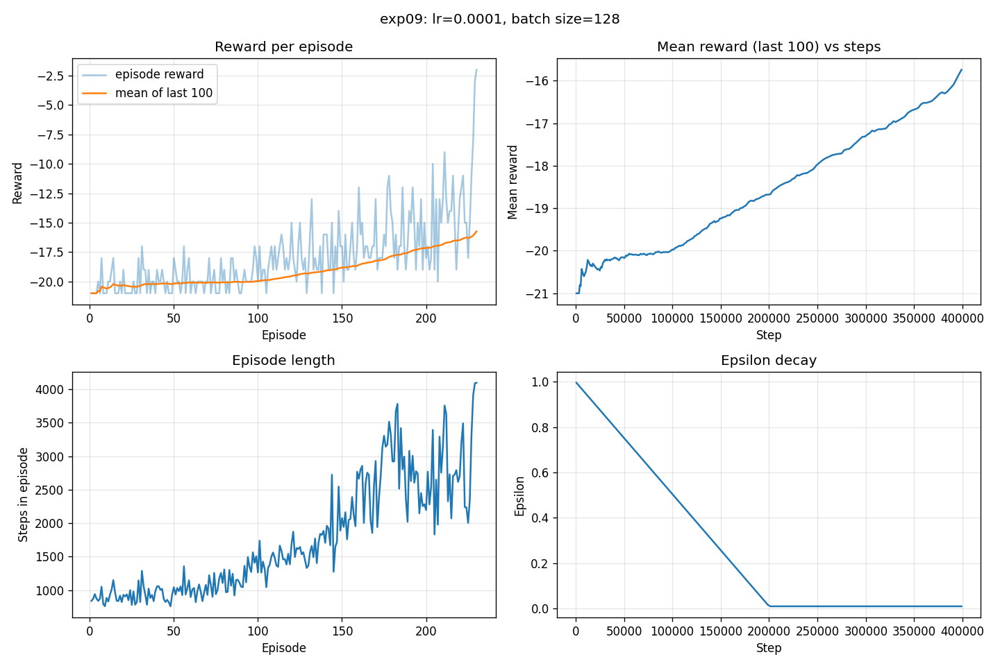

# DQN on Atari

A Deep Q-Network implemented from scratch in PyTorch and trained to play
`ALE/Pong-v5`. No Stable-Baselines3, RLlib, CleanRL or TorchRL.

> Skeleton. Each section is filled in by its owner — see the task allocation.

## Group members

- Alliane
- Anthony
- HonourGod

## The environment

We use `ALE/Pong-v5` from Gymnasium, which runs the Atari 2600 game through the
Arcade Learning Environment (ale-py). The setup is in `environment.py`.

### Game objective

Our agent controls the green paddle on the right and plays against the
computer's paddle on the left. A point is scored when the other side misses
the ball. The first player to reach 21 points wins and the episode ends.

The score of an episode is our points minus the opponent's points, so it goes
from -21 (we lost every point) to +21 (we won every point). A random agent
scores about -21. The agent has learned to play when its average score goes
above 0, which means it wins more points than it loses.

### Actions

Pong has 6 discrete actions:

| Index | Name | What it does |
| --- | --- | --- |
| 0 | NOOP | do nothing |
| 1 | FIRE | serve the ball |
| 2 | RIGHT | move the paddle up |
| 3 | LEFT | move the paddle down |
| 4 | RIGHTFIRE | move up and fire |
| 5 | LEFTFIRE | move down and fire |

In practice the agent only needs up, down and stay still, but we keep all 6
and let it learn which ones are useful.

### Rewards

The agent gets +1 when the opponent misses the ball, -1 when it misses the
ball, and 0 on every other frame. Most frames give 0, so the agent has to learn
which earlier moves led to a point. This is why the discount factor gamma
matters.

We also clip rewards to their sign (-1, 0 or +1). Pong rewards are already in
that range, so this changes nothing here, but it is part of the standard DQN
setup for Atari.

### What the agent sees

The game gives a 210 x 160 colour image. Before it reaches the network, we
process it the same way as the original DQN paper (Mnih et al., 2015):

1. At the start of each episode the agent does a random number of no-op
   actions (up to 30), so every game starts from a slightly different state.
2. Frame skip of 4: the chosen action is repeated for 4 frames and the agent
   only sees the last one. Neighbouring frames are almost identical, so this
   makes training about 4 times faster.
3. Each frame is converted to grayscale and resized to 84 x 84. Colour does not
   matter in Pong, and a smaller image means less computation.
4. The last 4 frames are stacked together. One frame shows where the ball is
   but not where it is going. With 4 frames the network can see the ball's
   direction and speed.

The observation is an array of shape `(4, 84, 84)` with pixel values 0 to 255.
We store it as `uint8` in the replay buffer to save memory, and the network
divides by 255 when it receives it.

Pong-v5 also has sticky actions: 25% of the time the game repeats the previous
action instead of the one the agent chose. This makes the game less predictable,
so the agent cannot memorise one fixed sequence of moves.

## DQN architecture

### The Q-network

One network maps a stack of 4 frames to one Q-value per action. The layer sizes
are the same as the 2015 DQN Nature paper. It is defined in `network.py` and
nothing is pretrained.

```
input: state (4, 84, 84) uint8          4 stacked grayscale frames, pixels 0-255
   |
   |  divide by 255.0                   done inside forward(), so the buffer
   v                                    can keep frames as 1-byte integers
 (4, 84, 84) float
   |
   |  Conv2d(4 -> 32, kernel 8, stride 4) + ReLU
   v
 (32, 20, 20)
   |
   |  Conv2d(32 -> 64, kernel 4, stride 2) + ReLU
   v
 (64, 9, 9)
   |
   |  Conv2d(64 -> 64, kernel 3, stride 1) + ReLU
   v
 (64, 7, 7)
   |
   |  Flatten
   v
 3136
   |
   |  Linear(3136 -> 512) + ReLU
   v
 512
   |
   |  Linear(512 -> 6)
   v
output: 6 Q-values, one per action
```

| Layer | Shape | Parameters |
| --- | --- | --- |
| Conv2d(4 -> 32, k8, s4) | (32, 20, 20) | 8,224 |
| Conv2d(32 -> 64, k4, s2) | (64, 9, 9) | 32,832 |
| Conv2d(64 -> 64, k3, s1) | (64, 7, 7) | 36,928 |
| Linear(3136 -> 512) | 512 | 1,606,144 |
| Linear(512 -> 6) | 6 | 3,078 |
| **Total** | | **1,687,206** |

The three convolutions shrink the image while growing the number of feature
maps: the first picks up coarse shapes and motion, the last works on a 7x7 grid
of higher-level features. The fully connected layers then turn those features
into a score for each of the 6 actions. Most of the parameters (95%) are in the
first linear layer, because it connects all 3,136 flattened features to 512
units.

### The online and target networks

We build two copies of this network, which is what `build_networks()` in
`train.py` does:

```
   state s                                   next state s'
      |                                            |
      v                                            v
 +--------------+                           +--------------+
 | online Q     |  <-- trained every        | target Q     |  <-- frozen, no
 | network      |      4 steps              | network      |      gradients
 +--------------+                           +--------------+
      |                                            |
      v                                            v
 Q(s, a) for the                            max Q(s', a') used in
 action we took                              the Bellman target
      |                                            |
      +------------------>  loss  <----------------+

 every 1,000 steps: copy the online weights into the target network
```

Only the online network learns. The target network is a snapshot of it, used to
produce the values we regress towards. Without it, the network is chasing a
target that moves every time it updates, which makes training unstable: the
prediction and the thing it is predicting shift together and the errors can
grow instead of shrink. Freezing the target for 1,000 steps gives the online
network a fixed goal to move towards.

## How training works

The loop lives in `train()` in `train.py`. One pass through it does five things.

**1. Choose an action (ε-greedy).** `get_epsilon()` returns the current
exploration rate, which falls in a straight line from `--eps-start` to
`--eps-end` over `--eps-decay` steps and stays there. `select_action()` then
draws a random number: below ε it picks a random action, otherwise it runs the
state through the online network and takes the action with the highest Q-value.
Early in training ε is near 1, so the agent is almost entirely exploring; later
it is near 0.01 and mostly exploiting what it has learned. The first 10,000
steps (`--warmup`) are fully random, to fill the buffer before learning starts.

**2. Store the transition.** The action is sent to the environment, and the
resulting `(state, action, reward, next_state, done)` tuple is written to the
replay buffer. `ReplayBuffer` is a fixed-size ring buffer of 50,000
transitions; when it is full, each new transition overwrites the oldest one.
Frames are kept as `uint8` rather than `float32`, which uses a quarter of the
memory — at 50,000 transitions it holds about 2.8 GB.

**3. Sample a batch and compute the Bellman target.** Every 4 steps
(`--learn-every`), `learn()` draws a random batch of transitions. Sampling
randomly is the point of the replay buffer: consecutive frames of Pong are
almost identical, so training on them in order would mean every batch is
highly correlated and the network would overfit to whatever it is doing right
now. A random batch mixes old and new experience together.

For each sampled transition the online network predicts the Q-value of the
action that was actually taken, and the target network supplies the value of
the best action in the next state:

```
target = reward + gamma * max_a' Q_target(next_state, a') * (1 - done)
```

The `(1 - done)` term matters: if the episode ended on that transition there is
no next state, so the target is just the reward.

**4. Compute the loss and backpropagate.** The loss is the mean squared error
between the predicted Q-values and those targets. `optimizer.zero_grad()`
clears the previous gradients, `loss.backward()` computes new ones, and
`optimizer.step()` updates the online network with Adam at the learning rate
from `--lr`. The target network is wrapped in `torch.no_grad()`, so no
gradients flow through it.

**5. Sync the target network.** Every 1,000 steps (`--target-sync`),
`update_target()` copies the online network's weights into the target network
with `load_state_dict()`.

At the end of each episode one row is written to `log.csv` — episode number,
step, total reward, episode length, ε and the latest loss — and the trained
weights are saved to `model.pth` when the step budget runs out.

## Results

Our best agent is experiment 9 from Alliane's sweep, saved as `dqn_model.pth`.
It was trained with:

```bash
uv run train.py --lr 1e-4 --gamma 0.99 --batch-size 128 \
                --eps-start 1.0 --eps-end 0.01 --eps-decay 200000 \
                --steps 400000 --buffer-size 50000 --seed 0 \
                --out experiments/Alliane/exp09
```



### Training performance

| | Start of training | End of training |
| --- | --- | --- |
| **Reward** (100-episode average) | -19.97 | **-15.74** |
| **Episode length** (50-episode average) | 918 steps | **2,805 steps** |
| **Number of steps** | 400,000 environment steps over 230 episodes | |

A random agent scores about -21, so the reward shows real learning rather than
noise. The 100-episode average first rose above -20 at step 101,471 and kept
climbing to the end of the budget, which means training was still improving
when it stopped.

Episode length is the clearer signal. A Pong episode ends when one side reaches
21 points, so a longer game means more of the ball being returned instead of
missed. Games grew three times longer, from 918 to 2,805 steps.

### Evaluation

Training averages include some exploration, so we also measured the saved model
playing greedily through `play.py` over ten fixed seeds:

| Model | Mean score | Median | Best | Worst |
| --- | --- | --- | --- | --- |
| **Alliane exp09** (saved as `dqn_model.pth`) | **-10.10** | -10.5 | -6 | **-13** |
| HonourGod exp10 | -11.20 | -14.0 | -1 | -20 |
| HonourGod exp03 | -14.70 | -14.5 | -10 | -18 |

We picked exp09 over exp10 for consistency rather than for its average. The two
means are within each other's error, and exp10 reached the better training
average (-14.39) and the only winning game of the project (+8). But across ten
greedy episodes exp10 ranged from -1 to -20 while exp09 stayed between -6 and
-13. A model that trains to a better average does not necessarily play more
reliably, and for a single demonstration the steadier agent is the better
choice.

### What limits the result

400,000 steps is a small budget for Pong — the original DQN paper trains for
tens of millions of frames, and agents usually need 1 to 2 million steps before
they score positively on average. We chose 400,000 so that all three of us
could run ten experiments each on the hardware we had, which made the
hyperparameter comparison the point of the project rather than the final score.
The reward curve had not flattened at 400,000 steps, so a longer run with the
same configuration would be expected to keep improving.

Per-member experiment tables are in the `*Hyperparameter_experiment_results.md`
files at the root of this repository.

## Gameplay demonstration

<!-- TODO (Alliane): video of the best trained agent playing. -->

## Running it

This project uses [uv](https://docs.astral.sh/uv/). Do not use pip.

```bash
uv sync            # create the environment from pyproject.toml / uv.lock
uv run train.py    # train (see --help for the hyperparameters)
uv run play.py     # watch the trained agent play
```

## Repository layout

```
train.py                                   training script
play.py                                    load dqn_model.pth and play greedily
plot_results.py                            training curves from a run's CSV
experiments/<Name>/experiments.ipynb       that member's 10 runs
experiments/<Name>/                        their models, logs and plots
*Hyperparameter_experiment_results.md      one table per member
dqn_model.pth                              the final trained model
Task allocation sheet.pdf                  who did what
```
